


&nbsp;
&nbsp;

<b>Español</b> · <a href="https://github.com/IzanVil/IzanVil/blob/main/README.en.md">English</a>

## Proyectos

<a href="https://github.com/IzanVil/RippleRack">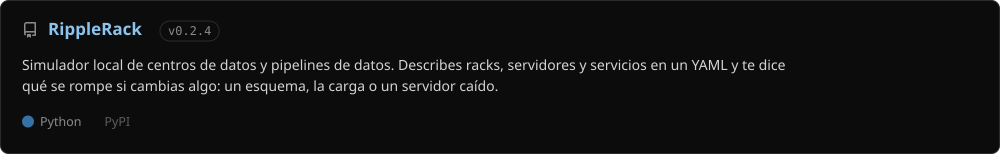</a>

<a href="https://github.com/IzanVil/datasemver">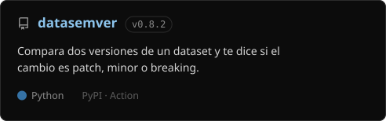</a>
<a href="https://github.com/IzanVil/mosaic">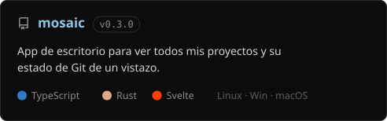</a>
<a href="https://github.com/IzanVil/rack-and-ruin">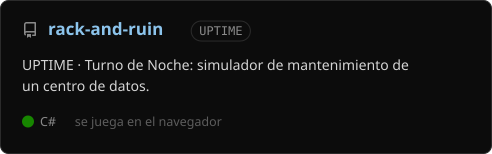</a>
<a href="https://github.com/IzanVil/last-click-game">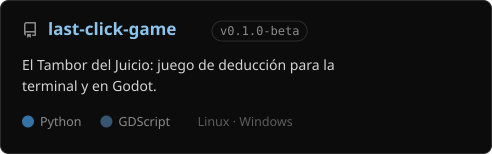</a>

Para probarlos: [RippleRack en PyPI](https://pypi.org/project/ripplerack/) · [datasemver en PyPI](https://pypi.org/project/datasemver/) · [Mosaic, descargas](https://mosaic-app.i-vilches.workers.dev) · [UPTIME en el navegador](https://izanvil.github.io/rack-and-ruin/)

## Contribuciones destacadas

<a href="https://github.com/microsoft/azure-linux-dev-tools/pull/365">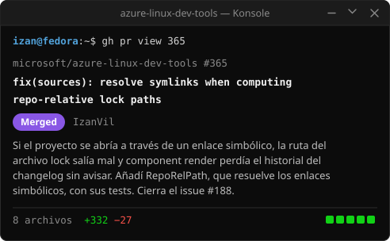</a>
<a href="https://github.com/microsoft/azure-linux-dev-tools/pull/392">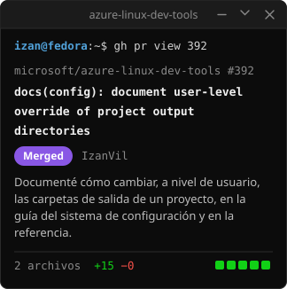</a>
<a href="https://github.com/microsoft/azurelinux/pull/18984">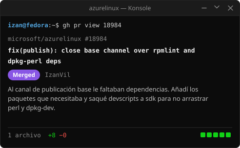</a>
<a href="https://github.com/microsoft/azurelinux/pull/18982">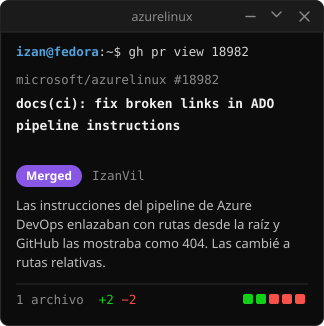</a>

## Sobre mí

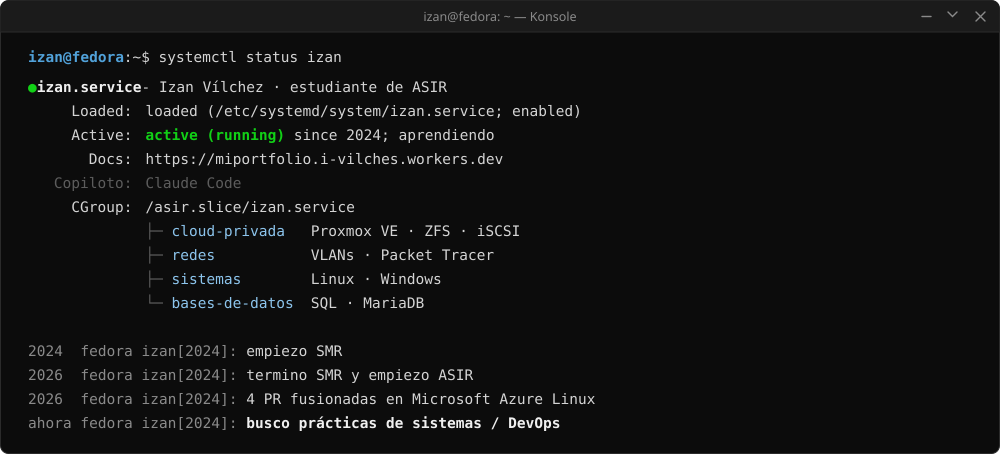

## Stack

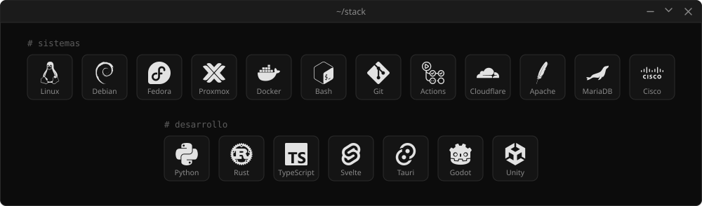

## Actividad

<picture>
  <source media="(prefers-color-scheme: dark)" srcset="https://raw.githubusercontent.com/IzanVil/IzanVil/output/serpiente-oscuro.svg"/>
  <source media="(prefers-color-scheme: light)" srcset="https://raw.githubusercontent.com/IzanVil/IzanVil/output/serpiente-claro.svg"/>
  
</picture>
